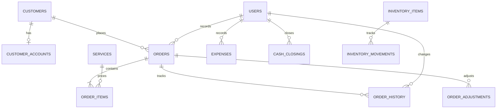

# System Analysis

**System:** Point-of-Sale and Laundry Shop Management System for Pia's Laundry Shop  
**Deployment:** PHP and MySQL/MariaDB on XAMPP or Laragon  
**Document purpose:** Describe the current system, its users, processes, requirements, data and boundaries.

## 1. Executive summary

The Laundry Shop Management System replaces paper-based recording of laundry
transactions and order progress with a browser-based application. It provides
separate work areas for administrators, staff/cashiers and customers. Shop staff
record and process orders; administrators maintain services and shop settings and
review operational reports; customers can create accounts, submit unpaid service
requests and review their own order history.

The application runs on a PHP web server and stores shared operational data in a
MySQL/MariaDB database. Staff-created sales and customer-submitted requests use the
same order records, allowing staff to process both through one order workflow.

## 2. Problem statement

Manual records make it difficult to calculate daily sales, locate order details,
know which laundry is ready, and review customer activity. They also make it harder
to keep service prices consistent and retain a useful history of transactions.
The system centralizes these records and provides a shared, current view of orders
and shop operations.

## 3. Objectives

### General objective

To provide Pia's Laundry Shop with a web-based system for recording sales,
managing services and customers, processing laundry orders, and reviewing shop
operations.

### Specific objectives

1. Record point-of-sale transactions with service quantities, prices, discounts,
   payment details and printable receipts.
2. Accept customer service requests through a customer account portal.
3. Keep staff and customer access separate and enforce administrator permissions
   for restricted shop-management functions.
4. Track orders from receipt through processing, readiness and pickup, with a
   recorded status history.
5. Maintain customer, service, employee, expense and inventory information.
6. Present sales and operating summaries through a dashboard and reports.

## 4. System boundary and scope

### Included functions

| Area | Current functions |
|---|---|
| Staff authentication | Admin and staff sign-in, session handling, account profile and password management |
| Customer accounts | Customer registration and sign-in using an email address and password; account-specific order list |
| Point of sale | Active service selection, cart, quantity, discount, payment method, change calculation and order creation |
| Customer ordering | Active service catalogue, quantity entry, live price estimate, customer order submission and order number |
| Order management | Search and filters, order details, status changes, status timeline, cancellation and refund records, receipt reprint |
| Customer tracking | Public status lookup using an order number and phone number |
| Customer records | Contact details, order history and customer totals |
| Service management | Create and update services, set unit and price, activate/deactivate services; administrator only |
| Shop operations | Expenses, supplies inventory and daily cashier cash closing |
| Reporting | Revenue, expenses, net sales, top services, payment methods and daily sales summaries |
| Administration | Employee accounts, shop and receipt settings, backup and restore |
| Notifications | Prepared SMS text opened through the device's messaging app for staff to review and send |

### Outside the current system boundary

- Payment processing, payment gateway integration and online collection of payment.
- Automatic SMS delivery or other external notification delivery.
- Multi-branch inventory, services, pricing or reporting.
- Customer delivery dispatch, driver tracking or online pickup scheduling.
- Public internet hardening, hosting operations and managed cloud backups.

## 5. Users and permissions

| User | Main responsibilities | Access |
|---|---|---|
| Administrator | Configure the shop, manage accounts and prices, oversee operations, reports and backups | Staff functions plus admin-only expenses, reports, services editing, inventory, employees, settings and backup/restore |
| Staff / cashier | Record sales, manage customers and process laundry orders | POS, order management, customer management and daily cash closing; no access to admin-only pages |
| Customer | Book service and follow personal orders | Registration and sign-in in the mobile app, service booking, private order history and delivery tracking |

Customer accounts are separate from staff accounts. A customer can only see orders
associated with their own customer record through the mobile app API. Staff and
administrator pages use the staff authentication and role checks.

## 6. Operational workflows

### 6.1 Staff sale

1. Staff signs in and opens the POS.
2. Staff selects active services and enters quantity by the service's unit (kg or
   piece).
3. The system obtains current service prices from the database, calculates line
   totals and the order total, and accepts applicable payment details.
4. The system stores the order and line-item price snapshots, associates the
   cashier and customer when applicable, and records the initial order history.
5. Staff prints the receipt and updates the order status as work progresses.

### 6.2 Customer service request

1. A customer creates an account with a name, phone number, email and password,
   then signs in.
2. The customer chooses currently active services and enters a quantity. Kilogram
   services accept decimal quantities; piece services require whole-number
   quantities.
3. The page displays an estimate using each current service price and quantity.
   The server reloads prices from the database and calculates the saved order
   total; browser-submitted prices are not used.
4. The system creates a Pending website order linked to the customer's account.
   The request is unpaid and does not represent a collected sale.
5. Staff sees the request in the shared Orders list, confirms it with the
   customer, collects payment at the shop and processes it through the normal
   order workflow.
6. The customer can review the order in the account portal or use the public
   order-tracking page.

### 6.3 Order processing

The ordinary status flow is **Pending → In Progress → Ready for Pickup → Picked
Up**. An order may be cancelled according to the system's cancellation controls.
Each status change is written to the order history with a timestamp and the
responsible staff account when the change is made by staff.

### 6.4 Cash closing and reports

Cashiers open a daily cash session, record an opening float and close the session
with counted cash. The system calculates expected cash from recorded cash
transactions and applicable adjustments. Reports summarize recorded sales,
expenses and service activity for selected dates. Unpaid customer mobile-app bookings
are excluded from revenue calculations.

## 7. Functional requirements

| ID | Requirement |
|---|---|
| FR-01 | The system shall authenticate staff accounts and apply administrator/staff authorization to protected pages. |
| FR-02 | The system shall allow customers to register and sign in using an email and password. |
| FR-03 | The system shall display active services with their pricing unit and current price. |
| FR-04 | The system shall calculate order amounts from database service prices and submitted quantities. |
| FR-05 | The system shall create staff sales and unpaid customer mobile-app bookings in the shared order database. |
| FR-06 | The system shall associate customer mobile-app bookings with the signed-in customer's record. |
| FR-07 | The system shall allow authorized staff to search, view and update orders and retain a status history. |
| FR-08 | The system shall provide receipt printing and mobile-app order and delivery tracking. |
| FR-09 | The system shall allow administrators to maintain services, employees, shop settings and backups. |
| FR-10 | The system shall allow authorized users to maintain customer information; administrators may access restricted management operations. |
| FR-11 | The system shall record expenses, inventory movements and cashier cash closings. |
| FR-12 | The system shall provide dashboard and report summaries and exclude unpaid mobile-app bookings from recorded revenue. |

## 8. Non-functional requirements

| Area | Requirement / current design |
|---|---|
| Platform | PHP 7.4+ with PDO MySQL, MySQL 5.7+ or MariaDB 10.3+, and Apache or compatible web server |
| Usability | Browser-based forms and tables for desktop and mobile-sized screens; the mobile app provides a booking estimate |
| Data integrity | InnoDB relationships, prepared SQL statements, server-side service repricing and database transactions for order creation |
| Security | Password hashing, CSRF tokens on state-changing forms, session ID regeneration at sign-in, output escaping and role checks |
| Availability | Availability depends on the local or hosted web server and database being operational |
| Maintainability | Plain PHP pages, shared authentication/helpers, SQL schema and project documentation; no build step required |
| Localization | Shop interface and the customer mobile app is primarily English; currency is Philippine peso |

The current documented deployment target is a shop computer or local network.
Public internet deployment requires additional operational security and hosting
work beyond the current scope.

## 9. Data analysis

The database stores users, customer profiles and accounts, service definitions,
orders and item snapshots, order history, expenses, settings, inventory records,
cash closings and order adjustments. Optional operational features are created
additively for existing installations.

### Core entities

| Entity | Purpose | Key relationships |
|---|---|---|
| `users` | Administrator and staff accounts | Referenced by orders, expenses, order history, inventory and cash closings |
| `customers` | Contact details and customer identity | One customer can have many orders and may have one customer account |
| `customer_accounts` | Customer email and password hash | One account belongs to one customer record |
| `services` | Active catalogue, unit, price and description | Referenced by order items when available |
| `orders` | Order identity, customer, status, totals, payment and timestamps | Has order items and status history; may reference a customer and staff creator |
| `order_items` | Service, unit, quantity, price and line total snapshot | Belongs to one order |
| `order_history` | Status and note audit trail | Belongs to one order and may identify the staff user |
| `expenses` | Operating expense details and payment method | May identify the creating staff user |
| `inventory_items` / `inventory_movements` | Supply balances and stock movement history | Each movement belongs to an inventory item |
| `cash_closings` | Opening and closing cash values per cashier and business date | Belongs to one staff user |
| `order_adjustments` | Cancellation and refund records | Belongs to one order and may identify the admin user |
| `settings` | Shop and receipt configuration in key/value form | Standalone settings records |

Service name, unit and price are copied to each order item when an order is
created. This preserves historical receipt amounts when a service is later
renamed or repriced.

### Conceptual relationship diagram

## 10. Business rules

1. Only active services can be selected for new POS or customer orders.
2. The server reads each selected service's price and unit from the database when
   saving an order; client estimates are informational only.
3. Kilogram quantities may use decimal precision. Customer orders for piece-based
   services require whole numbers.
4. Customer mobile-app bookings begin in Pending status, carry no collected payment,
   and are visible in the staff order workflow.
5. Revenue reports do not count mobile-app bookings with payment method `pending` as
   paid revenue.
6. Mobile API order queries are limited to the authenticated customer's ID.
7. Administrators alone may access service editing and other admin-only pages.
8. A receipt and order history retain the service and amount details that applied
   when the order was created.

## 11. Assumptions and constraints

- Shop staff maintain the service catalogue and current prices.
- Customers provide a reachable email and phone number during registration.
- Customer mobile-app bookings are reviewed and confirmed by shop staff; they are not
  automatically accepted as paid transactions.
- The application and database share the same shop timezone configuration
  (`Asia/Manila` in application code).
- The system supports one laundry shop location and one shared service catalogue.
- Email verification, password reset by email, and online payment are not currently
  included in the customer account workflow.

## 12. Success criteria

The system meets its operational goals when authorized users can sign in, staff
can record and process orders, customers can submit requests and see only their
own order history, administrators can maintain shop data, order totals match
database prices and entered quantities, and unpaid requests do not appear as paid
revenue in reports.

## 13. Related project documentation

- [System overview](01-system-overview.md)
- [Database design](02-database.md)
- [User guide](03-user-guide.md)
- [Project README](../README.md)
