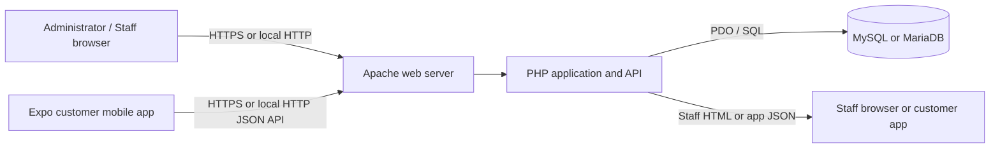
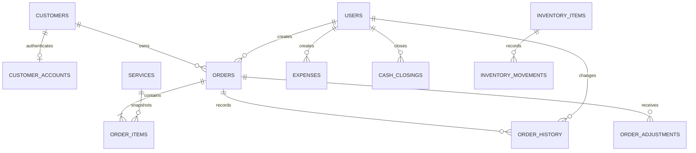
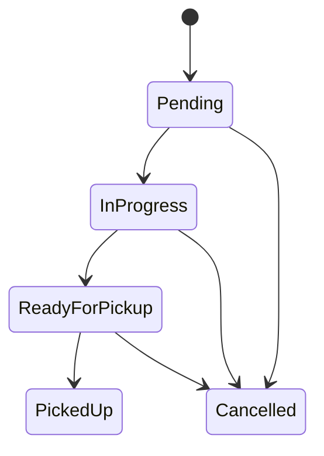

# System Design

**System:** Point-of-Sale and Laundry Shop Management System for Pia's Laundry Shop  
**Related document:** [System Analysis](04-system-analysis.md)  
**Technology:** PHP, PDO, MySQL/MariaDB, HTML, CSS and JavaScript

## 1. Design overview

The system combines a staff/admin web application with an Expo customer mobile app
and a shared relational database. Staff PHP page controllers handle browser
requests, check authorization, validate input, read or update records through PDO,
and return HTML pages. The mobile app calls authenticated PHP JSON API endpoints
for customer accounts, service bookings, order history and delivery tracking.
Shared authentication, helper functions, styles and database configuration are
kept in common files.

Staff-entered sales and mobile-app customer bookings use the same order tables.
Customer, payment, driver and creator fields distinguish the source and operational
state of each request without maintaining a separate order database.

## 2. Architecture

### 2.1 Logical layers

| Layer | Main parts | Responsibility |
|---|---|---|
| Presentation | Browser, PHP templates, `assets/css/style.css`, `assets/js/app.js` | Render staff/admin screens, forms, tables and receipts |
| Page/controller | Root PHP pages such as `pos.php`, `orders.php` and JSON endpoints under `api/` | Handle request routing, session checks, input validation, workflows and response generation |
| Shared application services | `includes/auth.php`, `includes/functions.php`, `includes/feature_schema.php` | Session setup, role guards, CSRF validation, escaping, order history, settings and additive schema setup |
| Data access | PDO connection in `config/database.php`; prepared statements in page controllers | Query and update data safely using parameterized SQL and database transactions |
| Persistence | MySQL/MariaDB database `laundry_pias` | Store users, customers, customer credentials, services, orders and shop operations |

### 2.2 Deployment view


The intended deployment is one shop or local network running Apache, PHP and
MySQL/MariaDB on XAMPP or Laragon. The customer mobile app needs network access
to the PHP API. Public internet deployment requires production hosting and
security setup beyond the current local-shop design.
### 2.3 Request lifecycle

1. A staff browser requests a PHP page or the mobile app calls a JSON API endpoint.
2. The page loads shared configuration and, for protected routes, starts or reuses
   a session and checks the required user role.
3. On a state-changing request, the controller validates the CSRF token and
   validates submitted values.
4. The controller obtains authoritative records and prices from MySQL using PDO
   prepared statements.
5. A transaction groups related order and order-item writes so they commit or roll
   back together.
6. The application redirects after successful form submissions or returns the
   rendered page/JSON result.

## 3. Application modules and route design

### 3.1 Staff and administration routes

| Page | Access | Design responsibility |
|---|---|---|
| `index.php` | Public entry; staff login | Authenticate administrator and staff accounts |
| `dashboard.php` | Staff and administrator | Display operational counts, revenue summaries and recent orders |
| `pos.php` | Staff and administrator | Create paid shop transactions from active services |
| `orders.php` | Staff and administrator | Search and filter the shared order queue |
| `order_view.php` | Staff and administrator; refund controls admin-only | Show order details, update status, record cancellation/refund and timeline |
| `receipt.php` | Authenticated staff and administrator | Render a printable receipt |
| `customers.php` | Staff and administrator; selected changes admin-only | Maintain customer records and display customer activity |
| `services.php` | Administrator | Maintain the service catalogue and prices |
| `expenses.php`, `reports.php` | Administrator | Record expenses and view financial/operational summaries |
| `inventory.php`, `backup.php`, `employees.php`, `settings.php` | Administrator | Manage supplies, database backup, user accounts and shop configuration |
| `cash_closing.php` | Staff and administrator | Open and close a cashier cash session |
| `profile.php` | Authenticated staff and administrator | Change the current staff account details/password |

### 3.2 Mobile customer app and API

The Expo app in `mobile_app/expo_app/` is the customer interface. It uses PHP JSON
endpoints under `api/`; staff and the mobile app read and update the same customer
and order records in MySQL.

| API | Access | Design responsibility |
|---|---|---|
| `api/register.php`, `api/login.php` | Public | Create a customer account or authenticate an existing account |
| `api/me.php`, `api/logout.php` | Signed-in customer | Read the account profile or end the app session |
| `api/services.php` | Public | Return active services and current prices |
| `api/tickets.php` | Signed-in customer | Create a pickup or delivery booking in the shared order tables |
| `api/my_tickets.php` | Signed-in customer | Show the customer's own orders and status history |
| `api/delivery_tracking.php` | Signed-in customer | Return authorized live delivery location details |
| `api/customer_delivery_location.php` | Signed-in customer | Receive delivery/pickup location details when provided |

Customer credentials and mobile API sessions are stored in the existing customer
account/session tables. The customer mobile app is separate from staff web sessions.

## 4. Data design

### 4.1 Database conventions

- Database: `laundry_pias`.
- Tables use InnoDB and `utf8mb4` character encoding.
- IDs are unsigned auto-increment integer primary keys.
- Foreign keys protect core relationships and apply `CASCADE` or `SET NULL` where
  appropriate.
- Order items store a snapshot of service name, unit, unit price and line subtotal
  so historical order values remain readable after price-list changes.
- `customer_accounts` is an additive table linked one-to-one with `customers`.
  It stores the login email and password hash; it does not replace customer
  contact data.

### 4.2 Core entity relationships



### 4.3 Important record fields

| Record | Design fields |
|---|---|
| Staff user | Name, unique username, password hash, role, active flag |
| Customer | Name, phone, optional contact fields, active flag |
| Customer account | Customer ID, unique email, password hash |
| Service | Name, category, unit (`kg` or `piece`), price, description, active flag |
| Order | Unique order number, customer, type, status, subtotal, discount, total, paid amount, change, payment method, pickup time, notes, creator and timestamps |
| Order item | Order ID, optional service ID, service name snapshot, unit, quantity, unit price and subtotal |
| Order history | Order ID, status, note, optional staff user and timestamp |
| Cash closing | Staff user, business date, opening/count/expected cash, variance, status and timestamps |
| Order adjustment | Order ID, adjustment type, amount, payment method, reason, optional staff user and timestamp |

## 5. Key workflow designs

### 5.1 Staff POS order

```mermaid
sequenceDiagram
    actor Staff
    participant Browser
    participant POS as pos.php
    participant DB as MySQL/MariaDB
    Staff->>Browser: Select active services and quantities
    Browser->>POS: Submit order with CSRF token
    POS->>DB: Load active service prices
    POS->>POS: Validate quantities and calculate totals/change
    POS->>DB: Begin transaction; insert order and item snapshots
    POS->>DB: Commit and record initial history
    POS-->>Browser: Return order number and receipt action
    Browser-->>Staff: Display order confirmation
```

The client cart is used for interaction only. The server re-reads service prices
before saving to prevent manipulated browser prices from changing the saved total.

### 5.2 Customer mobile booking

```mermaid
sequenceDiagram
    actor Customer
    participant App as Expo mobile app
    participant API as PHP JSON API
    participant DB as MySQL/MariaDB
    Customer->>App: Choose services and pickup or delivery
    App->>API: Submit booking with customer authentication
    API->>DB: Load current active prices and customer account
    API->>API: Validate values and calculate amount estimate
    API->>DB: Begin transaction; create Pending unpaid order and items
    API->>DB: Record customer order history; commit
    API-->>App: Return order number and unpaid notice
    App-->>Customer: Show booking and tracking details
```

The server calculates the estimate from current database prices. Customer bookings
are stored with payment method `pending` and amount paid zero. They appear in the
staff order queue but are excluded from revenue until staff record a paid transaction.

### 5.3 Order status lifecycle



Each status mutation updates `orders.status` and adds an `order_history` record.
Cancellation reason and refund information, when applicable, are recorded in
`order_adjustments`.

## 6. Interface and navigation design

### Staff interface

- Authenticated pages share a sidebar, top bar, flash messages and responsive
  content area through `includes/header.php` and `includes/footer.php`.
- The staff navigation exposes the operational pages available to both staff
  roles. Administrator-only navigation entries are filtered by role.
- Service editing is administrator-only at both the navigation and route level.
- Tables and filters support order, customer, inventory and report workflows.

### Customer mobile app interface

- The Expo app provides customer registration, sign-in, service booking and ticket history.
- Service cards show the current unit price and estimate before a booking is submitted.
- Customers can follow service status and, for deliveries, the driver's shared location.
- Customer bookings remain unpaid until shop staff confirm and collect payment.
## 7. Security and data protection design

| Control | Design |
|---|---|
| Password storage | Staff and customer passwords are stored as password hashes using PHP's password hashing functions |
| Authentication | Staff login uses the web session; customer sign-in uses the mobile API and active customer records |
| Authorization | Shared staff role guards protect staff routes; customer API tokens scope mobile requests to the signed-in account |
| Customer data isolation | Mobile API order queries filter by the authenticated customer ID |
| Request forgery | CSRF tokens protect staff forms; the mobile API validates customer authentication on account and booking requests |
| SQL injection | PDO prepared statements bind external input values |
| Output injection | Dynamic HTML values are passed through the shared escaping helper |
| Price integrity | Server reloads service prices and calculates totals; browser estimate is not authoritative |
| Session fixation | Session ID is regenerated after successful sign-in |
| Transaction integrity | Order, order-item and initial history writes are grouped in a transaction |

Customer email verification and password recovery are not implemented. The
current design is intended for local shop or local-network deployment; HTTPS,
server hardening, operational backups and public deployment controls must be
provided by the deployment environment if the system is exposed beyond the shop.

## 8. Error handling and validation

- Invalid form submissions return field-specific messages and do not save partial
  order records.
- Order creation rolls back related database writes when a transaction fails.
- Missing or deactivated services are rejected during server-side price lookup.
- Unauthorized users are redirected to the appropriate login or access page.
- Database connection failures produce a developer-facing setup message in the
  current implementation.
- Duplicate account email is rejected by the unique database constraint and shown
  as a registration error.

## 9. Design constraints and decisions

1. **Plain PHP pages:** fit the existing XAMPP/Laragon project and avoid a build
   or framework dependency.
2. **Shared order model:** mobile-app bookings and staff sales use the same order
   table so staff have one queue and one status lifecycle.
3. **Unpaid mobile-app bookings:** no payment gateway exists, so web requests are
   explicit requests and do not count as collected revenue.
4. **Price snapshots:** order item rows retain the values used when the order was
   created, independent of later catalogue edits.
5. **Additive customer account storage:** existing installations add the
   `customer_accounts` table without dropping shop data.
6. **Local deployment target:** the system is designed around a single shop and
   a local or shop-managed web server.

## 10. Deployment design

| Component | Deployment choice |
|---|---|
| Web server | Apache from XAMPP or Laragon |
| Runtime | PHP 7.4 or newer with PDO MySQL and JSON support |
| Database server | MySQL 5.7+ or MariaDB 10.3+ |
| Application files | Project directory under the web root, such as `C:\xampp\htdocs\laundry-pias` |
| Database setup | Import `database/laundry_pos.sql`; customer account and feature tables are added by the additive upgrade or on feature use |
| Access | Staff use the shop browser; customers use the mobile app over a network that can reach the PHP API |
| Backups | Administrator downloads the supported database JSON backup and stores it separately |

## 11. Traceability to analysis

| Analysis area | Design response |
|---|---|
| Separate admin/staff permissions | Shared authentication helpers, role checks and filtered navigation |
| Customer registration and sign-in | Customer account storage and authenticated mobile API |
| Mobile service bookings | App booking endpoint linked to customer records and shared orders table |
| Avoid uncollected online revenue | Pending payment marker and revenue exclusion rule |
| Current price accuracy | Server-side active service lookup and calculation |
| Order progress visibility | Shared orders list, status updates and order history |
| Retain historical pricing | Order item service and price snapshots |
| Local deployment | XAMPP/Laragon Apache, PHP and MySQL/MariaDB topology |

## 12. Related documentation

- [System analysis](04-system-analysis.md)
- [System overview](01-system-overview.md)
- [Database design](02-database.md)
- [User guide](03-user-guide.md)
